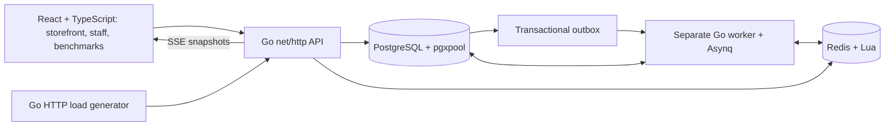

# BIZZNOVATE · The Dressing Room

A streetwear reservation system that connects online shoppers with real physical inventory. Customers reserve a size, receive a digital receipt and collect in store. Staff manage scanned units, fittings, checkout and physical returns. A separate benchmark dashboard shows what happens when real HTTP requests compete for limited stock.

**The inventory rule:** online reservations must leave at least two available units of each product and size for walk-in customers. Five available units therefore allow at most three online holds.

This repository includes the working local application, an interactive seven-slide presentation, an editable architecture slide and judging guides.

## Repository contents

| Path | Contents |
| --- | --- |
| [dressing-room-live/](dressing-room-live/) | Go API and worker, React/TypeScript frontend, SQL schema, local assets, fixtures and tests |
| [dressing-room-live/README.md](dressing-room-live/README.md) | Detailed setup, configuration, inventory contract and API reference |
| [dressing-room/](dressing-room/) | Offline HTML presentation, speaker notes, research references and presentation checks |
| [Architecture PowerPoint](dressing-room/output/dressing-room-system-architecture-final.pptx) | One editable slide with detailed speaker notes and a Hinglish speaking script |
| [Architecture explanation](dressing-room/dist/architecture-explained.md) | Full system explanation for rehearsal and judge questions |
| [Judging walkthrough](dressing-room-live/JUDGING.md) | Step-by-step live demonstration |
| [Requirement checklist](dressing-room-live/REQUIREMENTS.md) | Features and acceptance scenarios mapped to verification |
| [Verification report](dressing-room-live/VERIFICATION.md) | Executed checks, measured benchmark results and known limits |

## Run the live application

The supplied setup targets **x86_64 Omarchy/Arch Linux**. It starts user-owned PostgreSQL and Redis processes without Docker or root services. Go is downloaded into a local cache.

Prerequisites: Node.js/npm, Bash, make, GCC, Python 3, curl, tar with zstd support, ripgrep and the host libraries required by PostgreSQL. See the [runtime setup details](dressing-room-live/README.md#runtime-setup) before using another Linux distribution or operating system.

```bash
git clone https://github.com/23f2005639/techsprint.git
cd techsprint/dressing-room-live
make setup
make demo
```

Keep that terminal running. Open:

| Screen | Address | Purpose |
| --- | --- | --- |
| Storefront | http://127.0.0.1:8080/ | Product catalog, interest, reservations, receipts, notification inbox and Story PNGs |
| Staff | http://127.0.0.1:8080/staff | Scan units, start fitting, complete checkout, confirm returns and control the drop |
| Benchmarks | http://127.0.0.1:8080/benchmarks | Run concurrent HTTP scenarios, inspect inventory checks and download results |

On a fresh database, start in **Staff** and click **Launch drop**. In the storefront, enter a name or fictional customer alias above the collection, select a size and quantity, then click **Reserve your size**. Before launch, the button captures pre-drop interest instead.

If you are reopening an older browser tab, refresh with **Ctrl+Shift+R**. Action feedback appears beside the product, and a successful reservation brings the digital receipt into view.

The local staff key defaults to `local-demo-staff`. To change it:

```bash
STAFF_KEY='your-local-demo-key' make demo
```

Enter the same key under **Local staff / demo credential** in the staff and benchmark screens. Use the same `STAFF_KEY` when running the benchmark CLI.

## Timing and process controls

| Policy | `make dev` | `make demo` |
| --- | --- | --- |
| Online reservation | 24 hours | 120 seconds |
| Reminder before expiry | 2 hours | 10 seconds |
| FIFO offer window | 5 minutes | 20 seconds |
| Fitting overdue alert | 10 minutes | 30 seconds |

Accelerated timing is labelled in the UI. Fitting overdue alerts keep stock protected until staff confirms purchase or physical return.

- `make setup` downloads pinned runtimes and installs locked dependencies, then builds the app.
- `make dev` starts the API and worker with normal timing.
- `make demo` starts them with accelerated judging timing.
- `make build` builds the API, worker, load generator and frontend.
- `make test` starts local data services and runs the verification suite.
- `make stop` stops the API, worker, PostgreSQL and Redis.

Ctrl+C in the development terminal stops the API and worker. PostgreSQL and Redis keep running with their saved data until `make stop`. Runtime downloads, logs and database files stay in the ignored `dressing-room-live/.runtime/` directory.

## Architecture



| Component | Responsibility |
| --- | --- |
| React + TypeScript | Customer, staff and benchmark screens; browser-generated Story PNGs |
| Go `net/http` | JSON APIs, validation, staff credentials, idempotency and SSE streaming |
| PostgreSQL + `pgxpool` | Authoritative units, holds, request results, demand, waitlists, notifications and benchmark records |
| Redis + Lua through `go-redis` | Customer request counting and Asynq queue storage |
| Go worker + Asynq | Scheduled work, retries, reminders, expiry, eligible FIFO offers and recovery sweeps |
| Go load generator | Real loopback HTTP requests with bounded goroutine concurrency and observed timings |

Each physical unit has a scan code, size, location, online publication flag and state. A reservation transaction validates eligibility, assigns units, saves the hold and request result, and records its event and outbox work together. Repeating the same idempotency key and request replays the saved response.

This local build uses a conservative PostgreSQL transaction lock to serialize stock-changing operations across the API and worker. Online allocation selects published stockroom units and preserves the two-unit floor. Staff explicitly confirms placement before publishing display stock online. Checkout completes an existing hold, and expiry releases eligible stock once. A recovery sweep catches missed deadlines after interruptions.

The API serves the built frontend and local photographs from one origin. All services bind to loopback: API `8080`, PostgreSQL `55432`, Redis `56379`.

## Run real benchmarks

With `make demo` running, open a second terminal in `dressing-room-live`:

```bash
make bench SCENARIO=race REQUESTS=100 CONCURRENCY=100
make bench SCENARIO=five REQUESTS=100 CONCURRENCY=100
make bench SCENARIO=floor REQUESTS=100 CONCURRENCY=100
make bench SCENARIO=duplicate REQUESTS=100 CONCURRENCY=100
```

| Scenario | Expected unique holds for the short run |
| --- | --- |
| `race` | 1 hold, with 99 expected stock conflicts |
| `five` | 3 holds from 5 available units |
| `floor` | 0 online holds from 2 available units |
| `duplicate` | 1 hold and receipt replayed across 100 successful HTTP responses |

Each run uses an isolated benchmark variant. The dashboard shows observed RPS, p50/p95/p99 latency, response outcomes, inventory, database pool use, queue status and a bounded event timeline. It checks duplicate unit allocation, protected-floor compliance and inventory conservation. Final snapshots and request samples persist in PostgreSQL and can be downloaded as JSON/CSV.

Staff-authenticated benchmark requests bypass the customer admission gate to isolate stock contention. Results are local measurements, not production capacity guarantees. Keep fixed-winner judging runs shorter than the 120-second demo hold duration.

Run all four scenarios and check the live HTTP/SSE routes:

```bash
bash scripts/benchmarks.sh
python3 scripts/smoke.py
```

## Verify the implementation

From `dressing-room-live`:

```bash
make test
```

The suite uses a separate `dressing_test` PostgreSQL database and Redis database 1. It runs database-backed concurrency tests, real HTTP scenarios, worker restart/recovery checks, Go unit tests, `go test -race`, React interaction tests and the TypeScript/Vite production build. Database stock correctness and Go memory-race detection are separate checks.

Direct `go test` skips database integration tests when `TEST_DATABASE_URL` is absent. Use `make test` for the complete local workflow. See the [verification report](dressing-room-live/VERIFICATION.md) and [saved benchmark summary](dressing-room-live/verification/benchmark-summary.json) for executed evidence. Browser visual QA was unavailable during the recorded verification; DOM tests do not establish visual layout correctness.

The educational presentation has its own checks:

```bash
node dressing-room/check.cjs
```

## Present to judges

Open [dressing-room/dist/index.html](dressing-room/dist/index.html) locally in a browser. Arrow keys or Space advance slides, keys 1–7 jump to slides, **N** opens notes, **R** replays a demonstration and **F** requests fullscreen. Slide 6 explains the live Go architecture and has six technology controls.

The HTML slide demonstrations are educational simulations. Use the separate live app for real reservations, scanned inventory operations and HTTP measurements.

Presentation and rehearsal material:

- [Seven-slide presenter script](dressing-room/dist/presentation-script.md)
- [Detailed architecture and Hinglish narration](dressing-room/dist/architecture-explained.md)
- [Judges' questions and answers](dressing-room/dist/judges-qa.md)
- [Original and crisis requirement mapping](dressing-room/dist/requirements-map.md)
- [Live demonstration walkthrough](dressing-room-live/JUDGING.md)

## Downloadable delivery snapshots

These archives are intentional versioned handoff artifacts. The folders above contain the working source.

- [Original offline presentation ZIP](dressing-room-offline.zip)
- [Updated presentation and architecture PowerPoint ZIP](dressing-room-architecture-updated.zip)
- [Live application source ZIP](dressing-room-live-source.zip)

## Scope and credits

This is a local judging application with fictional customer aliases, a shared staff demo key, a loopback PostgreSQL cluster using trust authentication and illustrative pickup directions. Configure authenticated services and customer identity before considering a shared deployment.

Social analysis reads a bundled synthetic page and matches captions, comments and hashtags with product keywords. Reach and engagement are fixture values. Notifications arrive in the local inbox. External Instagram access, BERT training, external SMS/push and actual payment processing are outside this build.

Product photographs are category illustrations, and prices are illustrative INR. BIZZNOVATE branding and the problem briefs were supplied for the project. See [photo credits](dressing-room-live/web/public/assets/credits.txt) and the presentation's [bundled logo license](dressing-room/dist/assets/logos/LICENSE). No project-wide open-source license has been added.
